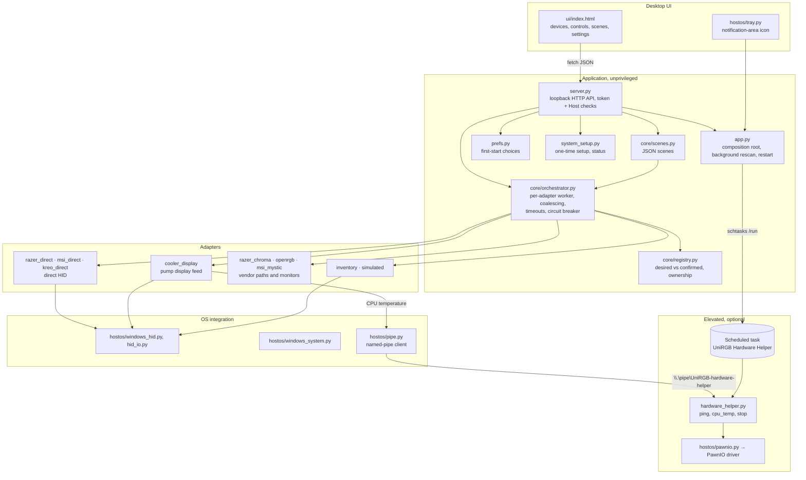

# Architecture

UniRGB is one unprivileged Python process (standard library only) that serves a single-page UI over loopback HTTP,
plus an optional elevated hardware helper for the features that need a kernel driver.

## Component diagram



## Control paths

```
Write:      UI ─POST /api/devices/{id}/apply→ server ─validate→ orchestrator ─queue(adapter)→
            adapter ─HID feature/output report→ device ─ack / read-back→ registry.confirmed

Discovery:  every 15 s (and on Rescan): HidCache.refresh() → each adapter.discover() on its own worker
            → registry.replace_adapter_devices() → ownership resolution (physical_key)
            → saved lighting re-applied to devices that came back (e.g. a mouse that woke up)

CPU temp:   cooler feeder (1 s) → pipe request {"op": "cpu_temp"} → helper reads SMN 0x59800 through PawnIO
            no answer → app starts the scheduled task (at most every 30 s) → falls back to LibreHardwareMonitor,
            then the GPU temperature
```

## Responsibilities

| Component | Owns | Never does |
|---|---|---|
| `DeviceAdapter` implementations | One control path: translating `LightingState` into device commands, session lifecycle | Threading policy, validating user input, persistence |
| `Orchestrator` | One single-thread executor per adapter (writes to one path are serialised, adapters run in parallel), latest-wins coalescing, timeouts, circuit breaker (3 failures → 10 s pause), capability validation | Talks to hardware |
| `DeviceRegistry` | Records, `desired` vs `confirmed` and the confirmation level, disconnect marking, cross-adapter ownership (`physical_key`: writable beats read-only, then lower priority wins) | Calls adapters |
| `SceneStore` | Versioned JSON at `%APPDATA%\UniRGB\scenes.json`, atomic replace with a `.bak`, refuses to overwrite an unreadable file | Applies states directly |
| `PrefsStore` | First-start choices in `%APPDATA%\UniRGB\prefs.json`; known keys and booleans only | Elevation |
| `system_setup` | The elevated one-time setup (`--system-setup`): installs PawnIO, copies the helper to `%ProgramFiles%\UniRGB Hardware Helper`, registers the task; status for the UI | Runs unless the user approved the UAC prompt |
| `hardware_helper` | Fixed requests over a named pipe only the signed-in user can open; exits on `stop` or after 60 s idle | Takes arguments, loads modules from outside its own admin-only folder |
| `server.py` | Loopback HTTP, per-run token for mutations, Host allow-list, body size cap, CSP | Business logic |
| `HidCache` | One HID enumeration per scan, shared by all adapters | Opens devices for I/O |

## Common device model (`core/models.py`)

* `DeviceInfo`: id, name, category, vendor and model, VID:PID, `physical_key`, control path, which apps control it, evidence.
* `Capabilities`: one `Support` level per operation (`supported / experimental / untested / blocked / unsupported`),
  effects, zones, `brightness_native`, notes. `writable` is derived from these, and the UI renders controls only from them.
* `LightingState`: mode, color, brightness 0–100, per-zone colors, speed, adapter-specific `extensions`.
* `DeviceRecord`: info + caps + connection (`connected / asleep / monitor-only / unavailable / error`) + **desired** +
  **confirmed** + confirmation level (`hardware-readback / device-ack / api-accepted / none`) + `last_error` + `shadowed_by`.

## Lifecycle

* **Single instance:** fixed port 47821 with address reuse off, so a second launch cannot bind and opens the running
  instance's window instead.
* **Background:** closing the window keeps UniRGB running; the tray icon shows it is running. The installer can add a
  sign-in entry (`--no-window`).
* **Quit** (button or tray menu): every adapter's `shutdown()` hands its device back (keyboard returns to its stored
  lighting, pump display is blanked), then the hardware helper is told to stop.
* **Restart** (`POST /api/restart`, used after the one-time setup): the app shuts down, frees its port and starts a
  fresh copy without a new window. The open page reloads when it sees the new instance's token.
* **Disconnect or sleep:** devices missing from a scan become `unavailable`, and a sleeping wireless mouse becomes
  `asleep`. Both keep their `desired` state, and it is re-applied when they return.
