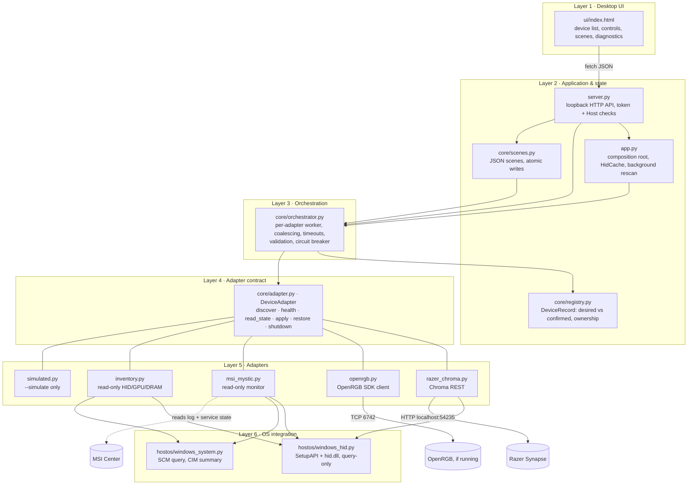

# Architecture

UniRGB is a single local process: a Python backend (standard library only) serving a single-page UI to an
Edge/Chrome `--app` window over loopback HTTP.

## Component diagram



## Control paths

```
Write (Razer):  UI ─POST /api/devices/{id}/apply→ server ─validate→ orchestrator ─queue(adapter "razer")→
                RazerChromaAdapter ─PUT {session}/mouse→ RzSDKServer → Synapse → HID → LEDs
                ◄ {"result":0} → confirmation = "api-accepted" → registry.confirmed

Discovery:      every 15 s (and on Rescan): HidCache.refresh() → each adapter.discover() on its own worker
                → registry.replace_adapter_devices() → ownership resolution (physical_key)
```

## Responsibilities

| Component | Owns | Never does |
|---|---|---|
| `DeviceAdapter` implementations | One control path: translating `LightingState` to vendor calls, session lifecycle | Threading policy, validation of user input, persistence |
| `Orchestrator` | One single-thread executor per adapter (writes to one path are serialised and adapters run in parallel), latest-wins coalescing, timeouts, circuit breaker (3 failures → 10 s pause), capability validation | Talks to hardware |
| `DeviceRegistry` | Records, `desired` vs `confirmed` + `Confirmation` level, disconnect marking, cross-adapter ownership (`physical_key`: writable beats read-only, then lower `priority`) | Calls adapters |
| `SceneStore` | Versioned JSON at `%APPDATA%\UniRGB\scenes.json`, atomic replace + `.bak`, refuses to overwrite an unreadable file | Applies states directly (goes through the orchestrator) |
| `server.py` | Loopback HTTP, per-run token for mutations, Host allow-list, body size cap, CSP | Business logic |
| `HidCache` | One HID enumeration per scan, shared by all adapters | Opens devices for I/O |

## Common device model (`core/models.py`)

* `DeviceInfo`: id, name, category, vendor/model, VID:PID, `physical_key`, control path, owning vendor apps, evidence list.
* `Capabilities`: one `Support` level per operation (`supported / experimental / untested / blocked / unsupported`),
  effects list, `Zone`s, `brightness_native`, notes. `writable` is derived. UI controls render only from these.
* `LightingState`: mode, color, brightness 0–100, per-zone colors, speed, `extensions` (typed per adapter).
* `DeviceRecord`: info + caps + connection (`connected / monitor-only / unavailable / error`) + **desired** +
  **confirmed** + `Confirmation` (`hardware-readback / api-accepted / none`) + `last_error` + `shadowed_by`.

## Lifecycle and recovery

* **Single instance:** fixed port 47821, with `SO_REUSEADDR` turned off on Windows so a second launch cannot bind. It opens the existing window instead.
  This prevents two UniRGB processes holding competing Chroma sessions.
* **Lazy takeover:** discovery never creates a Chroma session. The first user write does.
* **Clean exit:** the UI's **Quit** button (`POST /api/quit`) or `Ctrl+C` → `orchestrator.shutdown()` → each adapter's
  `shutdown()` → Chroma DELETE. Closing the window alone leaves the backend running and holding its lighting, the way a
  lighting service would. Re-launching opens the same instance.
* **Crash:** the Chroma session URI is journaled to `%LOCALAPPDATA%\UniRGB\chroma_session.json`. The next start deletes the stale
  session. Synapse itself also expired one within 120 s in testing.
* **Disconnect:** devices missing from a scan become `unavailable` and keep their `desired` state. Writes are refused until they return.
* **Synapse restart:** the session port disappears. The adapter abandons the session (best-effort DELETE) and recreates it once.

## Performance (measured 2026-10-19)

| Metric | Value |
|---|---|
| Full discovery including CIM PowerShell query | about 1.2–1.5 s (CIM dominates. Background rescans skip it) |
| Idle CPU (background rescan every 15 s) | 0.03 % of one core averaged over 60 s |
| Memory | 37 MB working set, 23 MB private, 14 threads |
| Chroma write latency | about 1 ms median after the session exists. The first write is about 580 ms |
| UI slider drag | client throttles to about 25 Hz with one request in flight. The server additionally coalesces queued writes |
