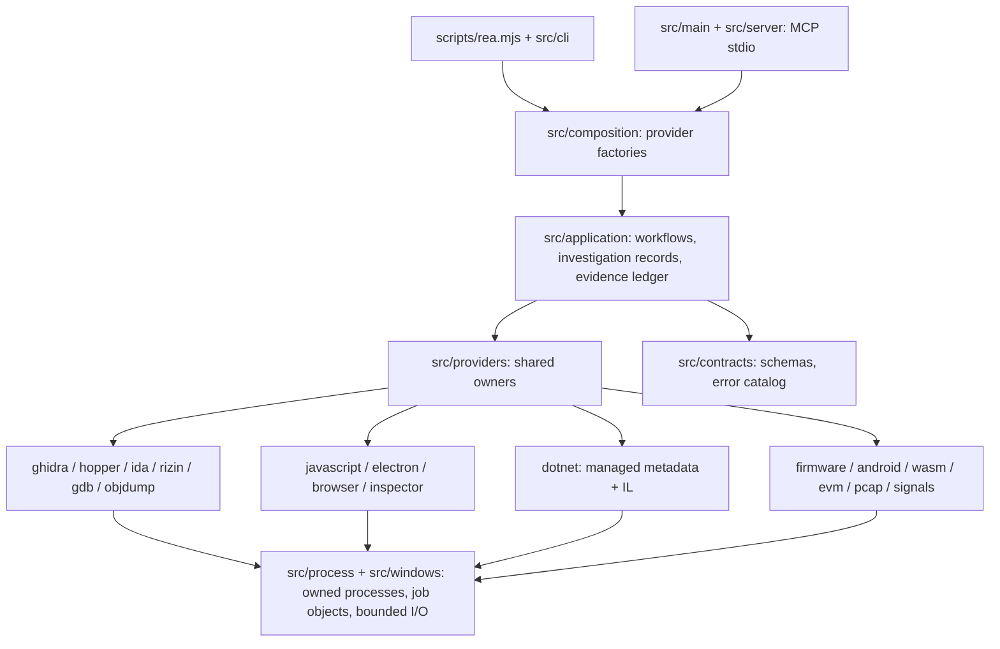

# Repository analysis: morluto/rea

Inspected clone: `https://github.com/morluto/rea` at commit `435efe7` (2026-10-19), package `rea-agents` 6.7.0,
4,451 tracked files. Read: README, LICENSE, package.json, `docs/architecture.mermaid`, `docs/signal-recordings.md`,
the `src/` module list, and a search of all of `src/` for device I/O APIs.

## What it is

REA ("Reverse Engineer Anything") is a **reverse-engineering toolkit exposed as a CLI and an MCP server**. It
lets an agent inspect native binaries (through Hopper, Ghidra, IDA, rizin, objdump, GDB), JavaScript and
Electron apps, .NET assemblies (PE/CLI metadata and IL), Android APKs, firmware images (binwalk/unblob),
WebAssembly, EVM bytecode, browser sessions (CDP/Playwright), and recorded captures (pcap, sigrok signal
recordings). Results come with evidence and stated limitations.

| Aspect | Finding |
|---|---|
| Language / runtime | TypeScript on Node.js `^22.19 \|\| ^24.11 \|\| >=26`. Some Python/Java/Swift bridges run inside analysis tools |
| Platforms | macOS, Linux, Windows (Windows: Ghidra provider, job-object process control in `native/windows`) |
| License | MIT. Bundled third-party notices for Ghidra (Apache-2.0) etc. |
| Tests | ~1,400 test files (vitest), mutation testing (Stryker), many "real-*" CI workflows |
| Device access | **None.** A search of `src/` for `hidapi`, `node-hid`, `libusb`, `WinUsb`, `HidD_`, `SetFeature` found nothing related to device I/O (the only hit is unrelated packet-capture text). `decode_signal_recording` explicitly "does not acquire samples or communicate with hardware" and is refused on Windows |
| Device model / capabilities | None. Its "capabilities" are analysis providers, not hardware features |

## Usefulness for this project

| Possible role | Verdict | Reason |
|---|---|---|
| Device-control library / backend | **No** | It has no USB, HID, SMBus or vendor-SDK code |
| Adapter or reference implementation for RGB protocols | **No** | No protocol implementations for any detected device |
| Static analysis of vendor apps (e.g. MSI Center .NET assemblies, Synapse's Electron bundle, `OemDrv.exe`) | **Yes, in principle** | Its .NET metadata provider and Electron/JS analysis fit exactly the "how does the vendor UI talk to its backend" question |
| Architectural inspiration | Partly | Its evidence-ledger and "no silent fallback" rules match this project's honesty requirements. UniRGB borrows the idea (every device carries `evidence` and explicit `Support` levels), not the code |

**Not run here.** Using REA needs Node.js 22+, which is not installed. Installing a system runtime needs the
user's approval (project rule 5), and none of this session's findings depended on it. The vendor architecture
facts in `reverse-engineering-findings.md` came from installed files, logs, sockets and documented APIs.

## Risks if adopted later

* A large dependency surface (Ghidra, JADX, Playwright and others) that is irrelevant to runtime device control. Keep it as a
  developer-side analysis tool, never a runtime dependency of UniRGB.
* Its setup command edits agent configuration files (it makes backups). Run it only deliberately.
* Disassembling vendor binaries may be restricted by their EULAs. Prefer published SDKs and observable
  interfaces, which is what UniRGB does.

## Decision

`rea` is **not integrated** into UniRGB. It stays recorded as an optional offline tool for future static analysis of
the Kreo KB Hub executable or MSI Center assemblies, with the user's approval to install Node.js.
